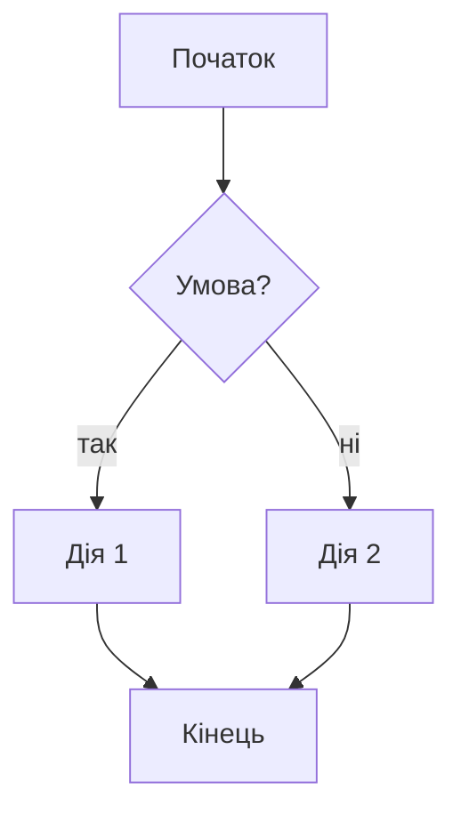

# Процес: … (назва вашого процесу)

<!-- Робота 12. Заповніть кожен розділ. Перевірка: python praktyka/12-process/perevir.py -->

## Опис

… 5–8 речень звичайною мовою: що відбувається, з чого починається, чим закінчується.

## Учасники

- … — що робить
- … — що робить

## Правила

```
When   …
If     …
Then   …
Else   …
```

## Схема



## Де тут SQL і регулярні вирази

- SQL: …
- Регулярний вираз: …
